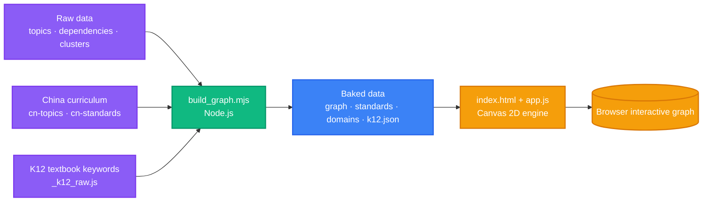
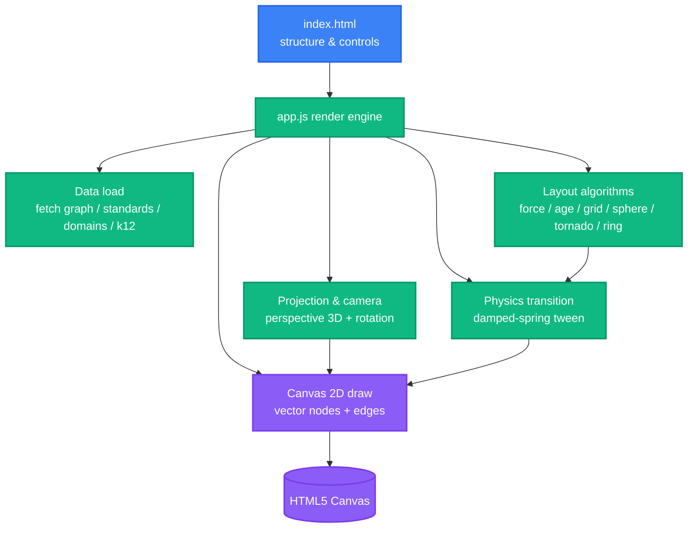

<div align="right">

[中文](README.md) · English

</div>

<h1 align="center">Everything a Child Learns · Marble Skill Taxonomy (Chinese Edition)</h1>

<p align="center">
  <strong>An explorable, traceable, and readable interactive knowledge graph—every subject a child studies in compulsory education, woven into one interdependent web.</strong>
  <br />
  <em>1,828 micro-topics · 3,896 prerequisite relations · 9 subject domains · 6 particle layouts · fully static · zero runtime dependencies</em>
</p>

<p align="center">
  <a href="#quick-start"></a>
  <a href="#license--attribution"></a>
</p>

<p align="center">
  
  
  
  
  
  
</p>

---

## Overview

*Everything a Child Learns* is the Chinese edition and master remake of [Marble Skill Taxonomy v1](https://github.com/baditaflorin/os-taxonomy) (© Generative Spark, Inc. / Marble). It decomposes everything a child learns during compulsory education into **1,828** micro-topics and **3,896** prerequisite relations—from speaking a first word to understanding algebra—presented as an **explorable, traceable, and readable** interactive knowledge graph.

Building on the previous Chinese-localization release, this edition extends the visual presentation, interaction paths, design detail, and information hierarchy:

- **New Chinese data**: aligned to the *Compulsory Education Curriculum (2022 Edition)*, the **full set of 9 subjects** was systematized, with **English added as a distinct subject** and 46 China-specific nodes introduced.
- **New China K12 textbook keyword library** (ported from `zhulin025/3DforTeacher`)—214 textbook keywords, 100% mapped into the graph.
- **New cross-disciplinary anchoring**: 344 bridging relations turn "nine parallel maps" into "one interdependent web".
- **New 6 particle layouts**: Star / Age Ring / Matrix / Sphere / Tornado / Ring, switched through a damped-spring physics engine while **preserving your current zoom and rotation**.
- **Ethereal Glass dark star-map paradigm**: fully vector rendering and an on-demand frame loop keep it sharp at any zoom.

> Data source: [Marble Skill Taxonomy v1](https://github.com/baditaflorin/os-taxonomy) (© Generative Spark, Inc. / Marble). As a derivative database, the Chinese edition carries the same licensing obligations (see [License & Attribution](#license--attribution)).

---

## Dataset at a Glance

| Metric | Value |
|---|---|
| Micro-topics (nodes) | 1,828 (incl. 46 China-2022 specific nodes + 192 K12 textbook keyword nodes) |
| Prerequisite relations (edges) | 3,896 (incl. 3,552 intra-subject prerequisites + 344 cross-disciplinary bridges) |
| Subject domains | 9 (Science / Math / Chinese Literacy / English / Information Technology / History / Life & Labor / Morality·Rule of Law·Comprehensive Practice / Learning to Learn (Cross-disciplinary Literacy)) |
| Curriculum standard mappings | 1,806 referenced foreign-standard codes + China 2022 standards |
| Textbook keyword library | 214 keywords, 100% resolved into the graph |
| Age span | Recommended start age 4–13 (some extend to 15) |
| Node types | Conceptual 1,008 · Procedural 518 · Metacognitive 166 · Linguistic 87 · Representational 49 |

---

## Core Features

### Six layouts, multi-perspective, zero-interruption switching

| Layout | Key | Form |
|---|---|---|
| Star | `force` | Force-directed: subjects cluster, age grows outward from the center |
| Age Ring | `age` | Age-as-radius subject petals; the further out, the older |
| Matrix | `grid` | A tidy catalog of 9 subjects × domains (183 domains) |
| Sphere | `sphere` | Fibonacci sphere shelled by age—the whole graph becomes a floating knowledge planet |
| Tornado | `tornado` | Age-as-height, subjects swirling around a cylinder |
| Ring | `ring` | Subjects around a major ring, age around a minor tube |

Switching runs through a **damped-spring physics engine** with smooth tweening, and `setLayout` deliberately skips camera reset—**your current zoom level and rotation viewpoint are strictly preserved** (no zoom-in, no pan, no recentering). In 3D layouts the graph auto-rotates slowly; hold **Shift + drag** or press **R** to rotate manually.

### Cross-disciplinary anchoring · nine maps → one web

Eleven semantic rules generate **344 "mutually reinforcing" bridging relations** across subjects such as Chinese ↔ Math ↔ English ↔ Science (verified: **100% connect distinct subjects**). These are render-only links that do not pollute the dependency chain, yet weave the graph into a genuinely interdependent web: a faint gold dashed mesh at rest, lighting up the borrowed knowledge across subjects (gold ring + flowing light) when you select a node.

### Ethereal Glass rendering (fully vector)

All 1,828 nodes are drawn as **pure vectors**—flat color core + crisp stroke ring + state ring—with no bitmap glow sprites, so rendering stays fast and stays sharp at any zoom, free of "blurry-on-zoom / dirty-shadow" artifacts. Unselected nodes are flat-filled by subject color; selected / prerequisite / dependent nodes are distinguished by white / warm-gold / indigo stroke rings. **All 3,896 edges are drawn by zoom threshold**—a clean constellation from afar, structure revealed up close. Rendering uses an **on-demand frame loop** (redraws only on interaction / tween), keeping interaction and scrolling fluid.

### Dependency-chain flowing light

Click any topic to **warm-gold-highlight all upstream prerequisites** and **indigo-highlight all downstream unlocks**, with flowing light on the edges marking dependency direction; unrelated nodes gently fade out, focusing your view on that one learning chain.

### Knowledge drawer and six curriculum annotation types

Open any node and the glass detail panel shows the full context: subject / domain cluster / suggested age / type / summary / assessment prompt / mastery evidence / **foreign-standard references (six annotation types)** / prerequisites / dependents—and prerequisite / dependent entries are clickable to keep exploring.

Referenced standards are grouped by system with Chinese explanations. The UK National Curriculum 2013 keeps its native Chinese titles; CCSS-ELA / CCSS-Math / NGSS / IB-PYP-PSPE exist only as codes, so they are decoded into Chinese annotations by structural rules (e.g. `L.K.1f` → "Language · Kindergarten · Standard 1f", `3-LS4-1` → "Science · Grade 3 · Life Science Topic 4 · Item 1").

### China Curriculum (2022 Edition) full integration · English included

A new `cn-2022` system, built from the *Compulsory Education Curriculum (2022 Edition)*, systematizes **all 9 subjects** by "preschool transition / Stage 1–4" (literacy, pinyin, reading, number sense, reasoning awareness, model conception, English enlightenment / phonics / topical communication / cultural awareness, rule-of-law conception, sound personality, labor spirit, information responsibility…).

- **Chinese and Math** are deepened—preschool transition and primary-stage refinements added.
- **English is added as a distinct Chinese subject** (10 nodes, from interest enlightenment to learning ability, cross-anchored to Chinese reading, etc.).
- It both **heuristically maps** to many existing nodes (same topic + overlapping age + domain keywords) and **adds 46 China-specific nodes** (pinyin, stroke order, classical poetry, number sense, operational ability, data awareness, scientific inquiry practice, political identity, revolutionary tradition, English enlightenment…) auto-linked into the graph.
- The detail panel pins the "China Curriculum (2022 Edition)" group on top, directly showing the node's **content requirement + stage + domain**.

### China Curriculum Spine (stage-by-stage roaming)

The top-bar "🧭 China Curriculum Spine" button enters a one-click mode—all non-China nodes fade to 10% opacity, the 46 `cn_` nodes are strung into a national-curriculum path with a **gold spine**, and the current stage ("preschool transition / Stage 1–4") is highlighted; a bottom gold glass capsule shows the current stage name and node count, with "‹ / ›" to roam stage by stage as the camera flies to each stage's node cluster.

### China K12 textbook keyword library

The top-bar "📖 Textbook Keyword Library" button browses national-curriculum and textbook-catalog knowledge by "stage → grade → subject → keyword"; clicking any keyword flies the star-map camera to the corresponding node (214 keywords, 100% in-graph).

### Learning Guide · Explain · Assess · Roadmap · Learning Map

Turning a beautiful graph into a usable learning companion:

- **Explain layer**: a native-language short essay on "what this topic really is and why it matters", with graph-derived type, centrality, unlocks, and a first step.
- **Assess layer**: auto-generates a self-test along the prerequisite chain, with per-item "have I done this?" evidence checks phrased as a conversational question using the learner's name.
- **Roadmap layer**: computes the transitive closure to a target node and buckets it into a 12-week growth map by mid-age, listing the keystones to tackle each week.
- **Learning Map explorer**: multiple learner profiles (localStorage-persisted), "mastered / in-progress" tri-state marking, hide-mastered, ring progress + "next step" suggestions, and a traceable growth timeline.

### Interaction, search, and accessibility

- Click to select and fly-to-center, double-click to focus-zoom, wheel / pinch to zoom anchored at the cursor, drag to pan; the top bar and subject bar are widened to **1760px** so **all 9 subjects display in one row** without horizontal scroll, and the "Learning Map · Progress" bar below is widened to match.
- Full-text search, subject show/hide, age-range filter (incl. a "≥X years" slider).
- Light/dark dual themes (Obsidian / Parchment), keyboard shortcuts, mobile drawer, `prefers-reduced-motion` friendly, global focus ring.

---

## Quick Start

A fully static site—**no build step required**. Serve the `site/` directory with any static server:

```bash
cd os-taxonomy-zh-art/site
python3 -m http.server 8731
# open http://127.0.0.1:8731/ in your browser
```

> ⚠️ Opening `index.html` directly via `file://` is blocked by browser security policy from `fetch`-ing local JSON; always use a local server.

### Regenerate data (optional)

Data is baked by `build_graph.mjs`. If you edit source files under `data/`, re-run with Node.js 18+:

```bash
node build_graph.mjs
# regenerates site/data/{graph,standards,domains,k12}.json
```

---

## Usage Guide

### Top-bar controls

| Control | Action |
|---|---|
| Layout switch (Star / Age Ring / Matrix / Sphere / Tornado / Ring) | Switch the six particle layouts; physics tween preserves viewpoint |
| 🔄 Rotate | Toggle auto-rotation in 3D layouts (also R key) |
| 📖 Textbook Keyword Library | Browse stage → grade → subject → keyword; click to fly to node |
| 🧭 China Curriculum Spine | Enter China-curriculum stage-by-stage roaming |
| 🗺️ Learning Map | Enter the multi-learner profile explorer |
| ☰ Menu | Subject encyclopedia, learning path, search & filter, theme switch, help |

### Canvas interaction

| Action | Effect |
|---|---|
| Click a node | Select and fly-to-center, expand dependency-chain highlight |
| Double-click a node | Focus-zoom |
| Wheel / pinch | Zoom anchored at the cursor |
| Drag | Pan the canvas |
| Shift + drag | Rotate the viewpoint (in 3D layouts) |
| R key | Toggle auto-rotation |
| Esc key | Close popups / keyword library |

---

## Architecture

### Data pipeline (build time)



### Browser runtime architecture (run time)



---

## Project Structure

```
os-taxonomy-zh-art/
├── README.md              Chinese documentation
├── README.en.md           English documentation
├── LICENSE                ODbL 1.0 (database layer)
├── LICENSE-CONTENT       CC BY-SA 4.0 (Marble-authored text layer)
├── PROVENANCE.md          Curriculum source & upstream licensing notes
├── CITATION.cff           Formal citation format
├── build_graph.mjs        Data baking script (regenerates site/data)
├── _merge_cn.mjs          Chinese data merge utility
├── data/                  Localized raw data
│   ├── topics.json            Micro-topics (localized)
│   ├── dependencies.json      Prerequisite relation graph
│   ├── clusters.json          Subject / domain clustering
│   ├── cn-topics.json         China curriculum processed topics
│   ├── cn-standards.json      China 2022 standards
│   └── _k12_raw.js            China K12 textbook keyword library (raw)
└── site/
    ├── index.html         Page structure, controls, and modals
    ├── css/styles.css     Design system (Ethereal Glass)
    ├── js/app.js          Render & interaction engine (Canvas 2D)
    └── data/
        ├── graph.json     Nodes + edges + adjacency + subject colors (baked coords)
        ├── standards.json Condensed referenced-standard map
        ├── domains.json   Subject → domain index
        └── k12.json       Textbook keyword library (by stage / grade / subject)
```

---

## Tech Stack

| Layer | Technology | Purpose |
|---|---|---|
| Runtime | Any static file server (e.g. `python3 -m http.server`) | Hosts `site/` |
| Rendering | HTML5 Canvas 2D (native, no WebGL / Three.js / D3) | Vector star-map, edges, labels |
| Logic | Vanilla JavaScript (ESM build script + browser IIFE engine) | Projection, layout, physics, interaction |
| Styling | CSS3 (CSS-variable design system + glassmorphism) | Ethereal Glass visuals |
| Data baking | Node.js 18+ (build time only) | `build_graph.mjs` generates `site/data` |

**Zero runtime third-party dependencies**: the browser loads no CDN or npm package; the whole site runs fully offline.

---

## Data Sources & Build

- **Upstream taxonomy**: [Marble Skill Taxonomy v1](https://github.com/baditaflorin/os-taxonomy) (© Generative Spark, Inc. / Marble).
- **China curriculum**: derived from the *Compulsory Education Curriculum (2022 Edition)* by AI organization and human review.
- **K12 textbook keyword library**: ported from [zhulin025/3DforTeacher](https://github.com/zhulin025/3DforTeacher) `public/curriculum-keywords.js`.
- **Cross-disciplinary anchoring**: eleven semantic rules generate render-only bridges (see the `CROSS` array in `build_graph.mjs`).

Build flow:

```bash
# 1. Source files under data/ are shipped with the repo—ready to use
# 2. Run the baking script
node build_graph.mjs
# 3. Start a static server
cd site && python3 -m http.server 8731
```

> The repo already ships the baked `site/data/*.json`, so it works out of the box; rebuild only when you change source data.

---

## Contributing

Issues and Pull Requests are welcome:

1. Fork the repository.
2. Create a feature branch (`git checkout -b feature/your-amazing-idea`).
3. Commit your changes (`git commit -m 'feat: describe your change'`).
4. Push to the branch (`git push origin feature/your-amazing-idea`).
5. Open a Pull Request.

If you modified source files under `data/`, please also run `node build_graph.mjs` to update `site/data/*.json` and describe the data change in your PR.

---

## License & Attribution

This dataset is released under **multiple licenses**; as a derivative database, the Chinese edition carries the same obligations:

- **Database layer**: [ODbL 1.0](LICENSE)—usable for research and commercial use, but requires **attribution**, and derivative databases must be shared alike under ODbL (kept open).
- **Marble-authored text layer**: [CC BY-SA 4.0](LICENSE-CONTENT)—attribution + share-alike.
- **Curriculum layer**: each source follows its own upstream license (see [PROVENANCE.md](PROVENANCE.md)). Sources with licensing burden ship code-only, not verbatim text.

Any use must attribute:

> Marble Skill Taxonomy (v1) · © Generative Spark, Inc. (Marble) · https://withmarble.com ·
> Database licensed under ODbL 1.0, text licensed under CC BY-SA 4.0.

If you use the curriculum standards, also include the upstream statements from `PROVENANCE.md`.

⚠️ When using this dataset in a commercial product, the product itself may be closed-source; but any extension / modification to **the taxonomy itself** must be contributed back under ODbL 1.0.

---

## Citation

To cite this dataset academically or in written work, refer to `CITATION.cff`:

```bibtex
@dataset{marble_skill_taxonomy_2026,
  author = {Boniface-Chang, Guillaume and Generative Spark, Inc. (Marble)},
  title  = {Marble Skill Taxonomy},
  year   = {2026},
  version = {v1.0},
  url    = {https://withmarble.com},
  license = {ODbL-1.0}
}
```

> The Chinese edition (os-taxonomy-zh-art) adds localization, China-curriculum integration, the K12 library, and cross-disciplinary anchoring; cite the source separately when appropriate.
