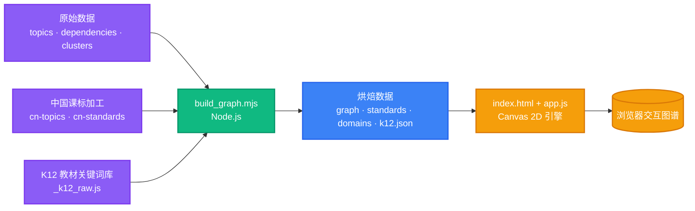
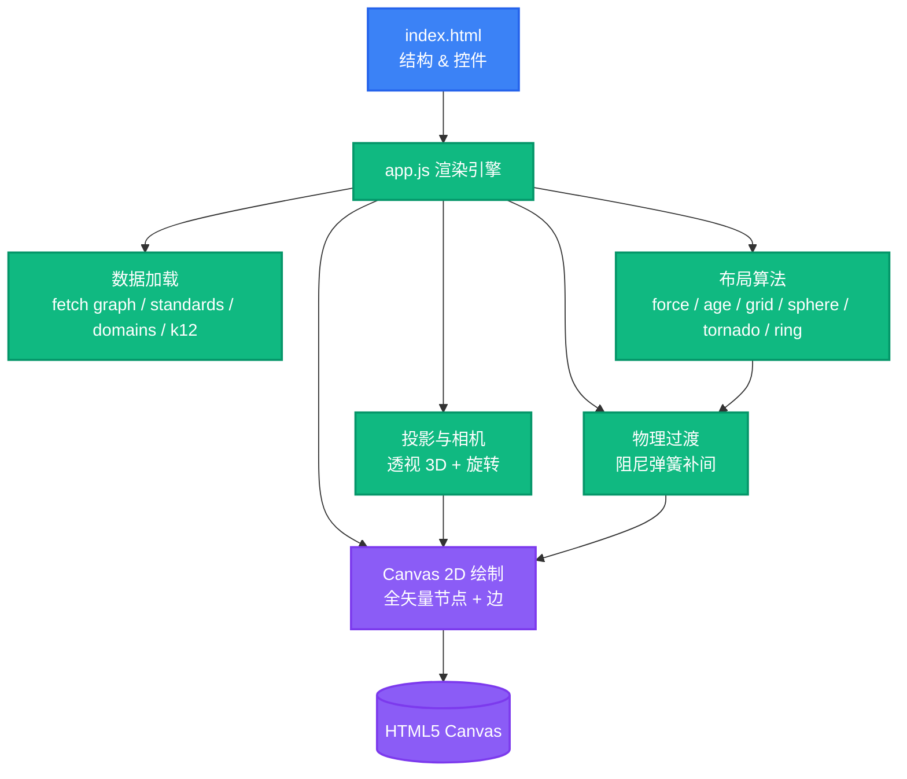

<div align="right">

中文 · [English](README.en.md)

</div>

<h1 align="center">孩子所学的一切 · Marble 技能分类法（中文版）</h1>

<p align="center">
  <strong>一张可漫游、可追溯、可品读的交互式知识图谱艺术品——把义务教育阶段的全部所学，拆成一张互相借力的网。</strong>
  <br />
  <em>1835 个微主题 · 3919 条前置关系 · 9 个学科门类 · 6 种粒子布局 · 纯静态 · 零运行时依赖</em>
</p>

<p align="center">
  <a href="#快速开始"></a>
  <a href="#许可证与署名"></a>
</p>

<p align="center">
  
  
  
  
  
  
</p>

---

## 本分支：数学对齐《义务教育数学课程标准（2022年版）》（试点）

> 分支 `cn-math-2022`，fork 自 [bewho/os-taxonomy](https://github.com/bewho/os-taxonomy)。bewho 版已完成中文化，但"中国课标"只有 153 条粗粒度概括，并在构建站点时按"学科相同 + 年龄重叠 + 关键词"批量挂到节点上（站点数据里数学节点共挂了 1429 个这样的标签）。本分支先拿**数学**做逐条对齐的试点。

**做了什么**

- **课标条目**：逐页读教育部发布的课标扫描件，整理出小学三个学段 4 个领域的【内容要求】81 条，加上核心素养在小学阶段的 11 项表现，共 92 条。编码为本项目自定（`cn-math-2022:S2.NA.SL.03` = 第二学段·数与代数·数量关系·第3条）；只收自写转述和印刷页码，不收原文。
- **逐个对齐**：503 个数学微主题各有一条对齐记录，包括状态（对上课标 446 / 属初中及以后 50 / 中国课标没有 7）、关系（exact 或 partial）、最早学段、置信度和理由。对齐结果追加进 `topics.json` 的 `standards`，原有的 CCSS / 英国课程 key 全部保留。
- **中国特有节点**：从"没有任何原有主题对上"的课标条目新建了 10 个 `cn_math_*` 节点（如算盘、常见数量关系、等式的基本性质、用方向和距离确定位置、圆锥的体积），依赖边写在 `cn-dependencies.json`，已通过无环校验。
- **本地化**：114 个名称按内容重写（去掉"（7岁+）"一类后缀）；英镑、美元换成人民币；已对齐主题里的英制单位换成公制；指代孩子的"他"改为"孩子"。
- **校验层**：恢复上游 `schema/` 和 `validate.mjs` 并重写；bewho 版删掉了这一层。

**对齐中发现的 2022 版要点**（与英美课程差异最大的地方）

- 课标小学部分**没有方程**：只有"等式的基本性质"和"用字母表示数"，解方程在初中。
- **百分数**归入"统计与概率"领域；**负数**在第三学段"综合与实践"的主题活动里认识。
- **可能性只做定性描述**，不用分数表示概率；"随机现象"从第三学段才开始。
- **人民币、时分秒、东南西北**（第一学段），**年月日、克千克吨、八个方向**（第二学段）都放在"综合与实践"的主题活动里。
- **反比例**移到初中，小学只学正比例。
- 乘法口诀只到 9×9，二年级学完；"万以内的数"在第一学段（英国在 Y4，约晚一年）。

**文件**

| 文件 | 内容 |
|---|---|
| `data/cn-math-2022.json` | 92 条课标条目（编码、标题、转述、学段、领域、主题、页码） |
| `data/alignments/cn-math-2022.json` | 503 条对齐记录，**唯一事实来源** |
| `data/cn-topics.json` / `data/cn-dependencies.json` | 新增的 `cn_math_*` 节点和它们的显式依赖边 |
| `data/i18n/zh-CN/standards-overlay.json` | 外国课标条目的中文显示名（构建站点用） |
| `docs/cn-math-2022-report.md` | 审校报告：学段错位、低置信度、初中及课标外、未覆盖条目 |

**审校与更新流程**

```bash
# 1. 修改 data/alignments/cn-math-2022.json（审校过的条目把 review 改为 teacher-reviewed）
node scripts/sync-cn-alignment.mjs     # 同步进 topics.json 的 standards
node scripts/build-manifest.mjs        # 重算计数与 sha256
node scripts/validate.mjs              # 结构、引用、无环、同步、校验和；--verbose 看全部告警
node scripts/cn-alignment-report.mjs   # 重新生成审校报告
node build_graph.mjs                   # 重建 site/data（默认读写仓库内路径）
```

**注意**：所有对齐目前都是 LLM 草稿（`review: llm-draft`），尚未经教师审校。最值得先看的是审校报告第 1 节：109 个主题的中国学段与原年龄相差两年以上。

## 项目简介

「孩子所学的一切」是 [Marble 技能分类法 v1](https://github.com/baditaflorin/os-taxonomy)（© Generative Spark, Inc. / Marble）的中文版与大师级重制。它把儿童在义务教育阶段所学的一切，拆解为 **1835** 个微主题、**3919** 条前置关系——从说出第一个词，到理解代数——并以一张**可漫游、可追溯、可品读**的交互知识图谱呈现。

本项目在完整复用上一版中文本地化成果的基础上，对视觉呈现、交互路径、设计细节与信息层级做了全面增强：

- 新增 **中文数据**：依据《义务教育课程方案与课程标准（2022 年版）》，系统补充了**全部 9 个学科**的知识点，并**新增英语学科**与 46 个中国课标特有节点。
- 新增 **中国 K12 教材关键词库**（接自 `zhulin025/3DforTeacher`），214 个教材关键词 100% 入图。
- 新增 **跨学科锚定**：348 条桥接关系把「九张并列的地图」织成「一张互相借力的网」。
- 新增 **6 种粒子布局**：星图 / 年轮 / 矩阵 / 球体 / 龙卷风 / 环状，切换由阻尼弹簧物理引擎平滑补间，且始终维持你的缩放与旋转视角。
- 设计范式升级为 **Ethereal Glass 暗色星图**：全矢量渲染、按需帧循环，缩放到任意倍率都锐利干净。

> 数据来源：[Marble 技能分类法 v1](https://github.com/baditaflorin/os-taxonomy)（© Generative Spark, Inc. / Marble）。中文版作为衍生数据库，须遵守同等授权义务（见 [许可证与署名](#许可证与署名)）。

---

## 数据规模

| 指标 | 数值 |
|---|---|
| 微主题（节点） | 1835（含 56 个中国课标特有节点 + 189 个 K12 教材关键词节点） |
| 前置关系（边） | 3919（含 3571 条学科内前置 + 348 条跨学科锚定桥接） |
| 学科门类 | 9（科学 / 数学 / 语文（读写素养）/ 英语 / 信息科技 / 历史 / 生活与劳动 / 道德与法治·综合实践 / 学会学习（跨学科素养）） |
| 课标条目映射 | 1854 条（被引用的国外课标代码 + 中国 2022 年版标准，含数学 92 条细粒度条目中被引用的部分） |
| 教材关键词库 | 214 个关键词，100% 解析入图 |
| 年龄跨度 | 建议起始 4–13 岁（部分延展至 15 岁） |
| 节点类型 | 概念性 1008 · 程序性 518 · 元认知 166 · 语言 87 · 表征性 49 |

---

## 核心特性

### 六种布局，多维透视，切换零打断

| 布局 | 标识 | 形态说明 |
|---|---|---|
| 星图 | `force` | 力导向：学科环绕成簇、年龄由内向外生长 |
| 年轮 | `age` | 以年龄为半径的学科花瓣，越往外年龄越大 |
| 矩阵 | `grid` | 九大学科 × 领域（183 个领域）的规整目录 |
| 球体 | `sphere` | 按年龄分壳的斐波那契球面，整图如一颗悬浮的知识星球 |
| 龙卷风 | `tornado` | 年龄即高度、学科绕柱旋转的粒子漩涡 |
| 环状 | `ring` | 学科绕大环、年龄绕细管的粒子甜甜圈 |

切换全程由**阻尼弹簧物理引擎**平滑补间，且 `setLayout` 明确不调用相机复位——**严格维持你当前的缩放倍率与旋转视角**（不拉近、不平移、不改变观察中心）。3D 布局下自动缓慢自转；按住 **Shift + 拖拽** 或按 **R** 键可手动旋转。

### 跨学科锚定 · 九张地图 → 一张网

以 11 组语义规则在 语文 ↔ 数学 ↔ 英语 ↔ 科学 等学科间生成 **348 条「互相借力」的桥接关系**（经校验 **100% 连接不同学科**）。这些桥接是「渲染态」链接，不污染依赖链，但让图谱真正织成一张互相借力的网：常态以极淡的金色虚线浮现，单击任一节点即点亮它与其它学科借力的知识点（金色环 + 流光）。

### Ethereal Glass 渲染（全矢量）

1835 个节点以**纯矢量**绘制——平涂色核 + 清晰描边环 + 状态环，彻底不用位图发光精灵（sprite），渲染更快、缩放到任意倍率都锐利干净、无「放大发虚 / 阴影发脏」；非选中态节点按主题色实心平涂，选中 / 前置 / 后续以白色 / 暖金 / 靛蓝描边环区分。**3919 条边按缩放阈值绘制**——远观为纯净星座，近看才显出结构。渲染采用**按需帧循环**（仅在交互 / 补间时重绘），交互与滚动极致流畅。

### 依赖链流光

单击任意知识点，**暖金色**高亮「往上追溯的全部前置基础」，**靛蓝色**高亮「往下解锁的全部后续知识」，连线上的流光标示依赖方向；无关节点悄然淡出，视野聚焦于眼前这条学习链。

### 知识抽屉与六类课标译注

点开任意节点，右侧玻璃详情面板呈现完整关联：学科 / 领域簇 / 建议年龄 / 类型 / 概述 / 评估提示 / 掌握证据 / **国外课标参考（六类译注）** / 前置知识 / 后续知识，且前置 / 后续条目可点击跳转继续探索。

参考课标按体系分组呈现，并附中文释义。英国国家课程 2013 直接采用其原生中文标题；CCSS-ELA / CCSS-Math / NGSS / IB-PYP-PSPE 仅存代码，故按结构规则解码为中文译注（如 `L.K.1f` →「语言 · 幼儿园 · 标准 1f」，`3-LS4-1` →「科学 · 3 年级 · 生命科学 主题 4 · 第 1 条」）。

### 中国课标（2022 年版）完整集成 · 含英语学科

新增 `cn-2022` 体系——依据《义务教育课程方案与课程标准（2022 年版）》，按「幼小衔接 / 第一～四学段」系统梳理**全部 9 个学科**的知识点（识字写字、汉语拼音、阅读积累、数与运算、数感、量感、推理意识、模型观念、英语启蒙 / 语音拼读 / 话题交际 / 文化意识、法治观念、健全人格、劳动精神、信息社会责任……）。

- **语文、数学**在原有基础上做深——补充幼小衔接与小学各学段的细化条目；
- **英语作为独立的中国学科新增**（10 个节点，从兴趣启蒙到学习能力，与语文阅读等知识交叉锚定）；
- 既**启发式对应**到现有大量节点（同主题 + 年龄重叠 + 领域关键词），又**新增 46 个中国特有节点**（拼音、笔顺、古诗文、数感、运算能力、数据意识、科学探究实践、政治认同、革命传统、英语启蒙等）自动连入图谱；
- 详情面板中「中国课标（2022 年版）」分组置顶，直接呈现该节点的**内容要求 + 学段 + 领域**。

### 中国课标主线（按学段漫游）

顶栏「🧭 中国课标主线」按钮一键开启——所有非中国节点淡出至 10% 透明，46 个 `cn_` 节点以**金色脊线**串成一条国家课程路径，并按「幼小衔接 / 第一～四学段」高亮当前学段；底部金色玻璃胶囊显示当前学段名与节点数，可「‹ / ›」逐级漫游，相机自动飞向该学段节点簇中心，让孩子顺着国家课程路径一路点亮知识。

### 中国 K12 教材关键词库

顶栏「📖 教材关键词库」按钮，按「学段 → 年级 → 学科 → 关键词」四级浏览国家课标与人教等教材目录中的知识点；点击任一关键词即在星图中飞向对应节点（214 个关键词 100% 已入图）。

### 学习向导 · 讲解 · 评测 · 路线 · 学习地图

把一张「看得美」的图谱，变成「用得上」的学习伙伴：

- **讲解层**：母语化短文解释「这个知识点到底是什么、为什么重要」，并由图谱实时推导其类型、中心度、解锁的后续知识与起步路径。
- **评测层**：沿前置链自动生成自测小卷，逐项自检「我做到了吗」，并以学习者姓名做对话式提问。
- **路线层**：以目标节点为终点求传递闭包，按适龄中点分桶成 12 周成长地图，每周列出该攻克的基石。
- **学习地图探索器**：可创建多学习者档案（localStorage 持久化），标记「已掌握 / 在学」三态、隐藏已掌握、查看环形进度与「下一步建议」，并写入可追溯的成长轨迹时间线。

### 交互、检索与无障碍

- 单击选中并飞向居中、双击聚焦放大、滚轮以光标锚定缩放、双指捏合缩放、拖拽平移；顶栏与学科条统一加宽至 **1760px**，**9 个学科门类一行完整展示**，无需左右滚动，下方「学习地图 · 进度追踪」栏同步加宽。
- 全文搜索、学科显隐、年龄段（含「≥X 岁」滑杆）筛选。
- 深浅双主题（Obsidian / Parchment）、键盘快捷键、移动端抽屉、`prefers-reduced-motion` 友好、全局焦点环。

---

## 快速开始

纯静态站点，**无需构建**。用任意静态服务器打开 `site/` 目录即可：

```bash
cd os-taxonomy-zh-art/site
python3 -m http.server 8731
# 浏览器访问 http://127.0.0.1:8731/
```

> ⚠️ 直接以 `file://` 打开 `index.html` 会因浏览器安全策略阻止 `fetch` 本地 JSON；请务必通过本地服务器访问。

### 重新生成数据（可选）

数据由 `build_graph.mjs` 烘焙。若你修改了 `data/` 下的源文件，需 Node.js 18+ 重新生成：

```bash
node build_graph.mjs
# 重新生成 site/data/{graph,standards,domains,k12}.json
```

---

## 使用指南

### 顶栏控件

| 控件 | 作用 |
|---|---|
| 布局切换（星图 / 年轮 / 矩阵 / 球体 / 龙卷风 / 环状） | 切换六种粒子布局，物理补间且保持视角 |
| 🔄 旋转 | 开启 / 关闭 3D 布局下的自动自转（R 键同效） |
| 📖 教材关键词库 | 按学段 → 年级 → 学科 → 关键词四级浏览，点击飞向节点 |
| 🧭 中国课标主线 | 进入中国课标按学段漫游模式 |
| 🗺️ 学习地图 | 进入多学习者档案的探索模式 |
| ☰ 菜单 | 学科百科、学习路径、检索与筛选、主题切换、帮助 |

### 画布交互

| 操作 | 效果 |
|---|---|
| 单击节点 | 选中并飞向居中，展开依赖链高亮 |
| 双击节点 | 聚焦放大 |
| 滚轮 / 双指捏合 | 以光标为锚点缩放 |
| 拖拽 | 平移画布 |
| Shift + 拖拽 | 旋转视角（3D 布局下） |
| R 键 | 切换自动旋转 |
| Esc 键 | 关闭弹窗 / 关键词库 |

---

## 架构

### 数据流水线（构建期）



### 浏览器端运行时架构（运行期）



---

## 目录结构

```
os-taxonomy-zh-art/
├── README.md              本文件
├── README.en.md           英文版说明
├── LICENSE                ODbL 1.0（数据库层）
├── LICENSE-CONTENT       CC BY-SA 4.0（Marble 撰写文本层）
├── PROVENANCE.md          课标来源与上游授权说明
├── CITATION.cff           正式引用格式
├── build_graph.mjs        数据烘焙脚本（重新生成 site/data）
├── _merge_cn.mjs          中文数据合并工具
├── data/                  已中文化的原始数据
│   ├── topics.json            微主题（已中文化）
│   ├── dependencies.json      前置关系图
│   ├── clusters.json          学科 / 领域聚类
│   ├── cn-topics.json         中国课标加工主题
│   ├── cn-standards.json      中国 2022 年版标准
│   └── _k12_raw.js            中国 K12 教材关键词库（原始）
└── site/
    ├── index.html        页面结构、控件与弹窗
    ├── css/styles.css     设计系统（Ethereal Glass）
    ├── js/app.js          渲染与交互引擎（Canvas 2D）
    └── data/
        ├── graph.json     节点 + 边 + 邻接表 + 学科配色（已烘焙坐标）
        ├── standards.json 被引用的课标条目精简映射
        ├── domains.json   学科 → 领域索引
        └── k12.json       教材关键词库（按学段 / 年级 / 学科）
```

---

## 技术栈

| 层 | 技术 | 用途 |
|---|---|---|
| 运行环境 | 任意静态文件服务器（如 `python3 -m http.server`） | 托管 `site/` |
| 渲染 | HTML5 Canvas 2D（原生，无 WebGL / Three.js / D3） | 全矢量星图、边、标签绘制 |
| 逻辑 | 原生 JavaScript（ESM 构建脚本 + 浏览器 IIFE 引擎） | 投影、布局、物理过渡、交互 |
| 样式 | CSS3（CSS 变量设计系统 + 玻璃拟态） | Ethereal Glass 视觉 |
| 数据烘焙 | Node.js 18+（仅构建期） | `build_graph.mjs` 生成 `site/data` |

**零运行时第三方依赖**：浏览器端不加载任何 CDN 或 npm 包，整站可完全离线运行。

---

## 数据来源与构建

- **上游分类法**：[Marble 技能分类法 v1](https://github.com/baditaflorin/os-taxonomy)（© Generative Spark, Inc. / Marble）。
- **中国课标**：依据《义务教育课程方案与课程标准（2022 年版）》由 AI 整理、人工审校。
- **K12 教材关键词库**：接自 [zhulin025/3DforTeacher](https://github.com/zhulin025/3DforTeacher) 的 `public/curriculum-keywords.js`。
- **跨学科锚定**：以 11 组语义规则在学科间生成渲染态桥接（详见 `build_graph.mjs` 中的 `CROSS` 数组）。

构建流程：

```bash
# 1. 准备 data/ 下的源文件（已随仓库提供，可直接用）
# 2. 运行烘焙脚本
node build_graph.mjs
# 3. 启动静态服务器
cd site && python3 -m http.server 8731
```

> 仓库已内置烘焙好的 `site/data/*.json`，开箱即用；仅在修改源数据时才需重新构建。

---

## 贡献指南

欢迎以 Issue 与 Pull Request 形式参与：

1. Fork 本仓库。
2. 创建特性分支（`git checkout -b feature/your-amazing-idea`）。
3. 提交改动（`git commit -m 'feat: 你的改动说明'`）。
4. 推送到分支（`git push origin feature/your-amazing-idea`）。
5. 发起 Pull Request。

若你修改了 `data/` 下的源文件，请一并运行 `node build_graph.mjs` 并更新 `site/data/*.json`，并在 PR 中说明数据变更。

---

## 许可证与署名

本数据集为**多重授权**，中文版作为衍生数据库须遵守同等义务：

- **数据库层**：[ODbL 1.0](LICENSE)——研究与商业均可使用，但须**署名**，且衍生数据库须以 ODbL **相同方式共享**（保持开放）。
- **Marble 撰写文本层**：[CC BY-SA 4.0](LICENSE-CONTENT)——署名 + 相同方式共享。
- **课标层**：各来源遵循其自身上游许可证（详见 [PROVENANCE.md](PROVENANCE.md)）。存在授权负担的来源仅随附标准代码，未纳入逐字原文。

任何使用都须署名：

> Marble 技能分类法（v1）· © Generative Spark, Inc.（Marble）· https://withmarble.com ·
> 数据库采用 ODbL 1.0 授权，文本内容采用 CC BY-SA 4.0 授权。

若使用了其中的课程标准，还须附上 `PROVENANCE.md` 中的上游声明。

⚠️ 将本数据集用于商业产品时，产品本身可闭源；但你对**分类法本身**的任何扩展 / 修改，须以 ODbL 1.0 公开回馈。

---

## 引用

如需在学术或作品中引用本数据集，可参考 `CITATION.cff`：

```bibtex
@dataset{marble_skill_taxonomy_2026,
  author = {Boniface-Chang, Guillaume and Generative Spark, Inc. (Marble)},
  title  = {Marble Skill Taxonomy},
  year   = {2026},
  version = {v1.0},
  url    = {https://withmarble.com},
  license = {ODbL-1.0}
}
```

> 中文版（os-taxonomy-zh-art）在此基础上做了中文化、中国课标集成、K12 库接入与跨学科锚定，引用时建议另行注明来源。
>
> `cn-math-2022` 分支（[ppray/os-taxonomy](https://github.com/ppray/os-taxonomy)）在 bewho 中文版基础上做了数学学科对《义务教育数学课程标准（2022年版）》的逐条对齐。署名链：Marble（原始数据）→ zhulin025 / bewho（中文版与可视化）→ 本分支（数学课标对齐）。
